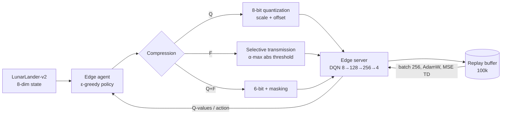

# CoKnight 2.0 — Bandwidth-Aware Deep Reinforcement Learning for Edge Computing

MSc thesis project (Artificial Intelligence, FST Béni Mellal, 2025) — Othmane Alaoui, supervised by Pr. Driss Ait Omar.

Edge devices running deep RL agents must exchange state information with an edge server over limited bandwidth.
CoKnight 2.0 extends the CoKnight actor/server architecture with **compression applied directly to the state vectors**
exchanged between agents and the server, and measures the trade-off between bandwidth saved and policy quality.

## Approach

- **Agent / server split**: a DQN (fully connected 8 → 128 → 256 → 4) is used by an `Actor` on the edge device;
  a `Server` holds the optimizer (AdamW, MSE TD loss) and updates the shared Q-network.
- **Training**: DQN with experience replay (buffer 100k, batch 256, γ = 0.99, ε-greedy 1.0 → 0.05, decay 0.995),
  2,200 episodes on `LunarLander-v2`.
- **Compression strategies** on the 8-dimensional state:
  - **Quantization (Q)**: 8-bit integers + scale/offset for reconstruction.
  - **Selective transmission (F)**: only dimensions above a relative amplitude threshold (α · max|s|) are sent.
  - **Hybrid (Q+F)**: quantization combined with filtering.

## Results (50 test episodes, LunarLander-v2)

| Strategy | Avg. reward | Success rate (reward ≥ 0) | Bandwidth reduction |
|---|---|---|---|
| Quantization 8-bit | 199.23 | 90% | 87.5% |
| Selective transmission | 187.17 | 92% | 80.67% |
| Hybrid: 6-bit quantization + masking | 128.33 | 76% | 55.12% |
| Hybrid: filtering + 8-bit (left-padded) | −163.29 | 4% | 51.44% |

**Takeaway**: 8-bit quantization removes ~87% of transmitted data while the agent still lands successfully in 90% of
episodes. Hybrid compression hurts the policy; when filtered values are re-packed to the front of the vector
(last variant), each feature loses its position and the agent fails, so masking in place is required.

## Run it

The notebook was developed on Kaggle (GPU). To run locally:

```bash
pip install -r requirements.txt
jupyter notebook notebooks/coknight2_lunarlander.ipynb
```

Note: one cell loads pretrained weights from a Kaggle dataset path (`/kaggle/input/...`). Skip it to train from scratch,
or point it to your own `coknight_lunarlander.pth`.

## Stack

Python · PyTorch · OpenAI Gym (Box2D) · NumPy · Matplotlib · Seaborn

## Author

Othmane Alaoui — [github.com/othy118](https://github.com/othy118)

## Architecture


